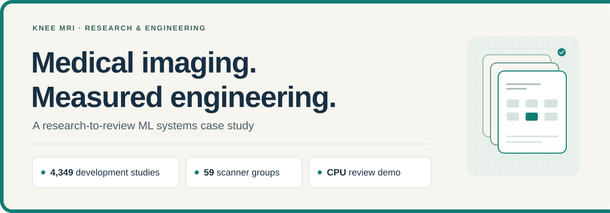

# RSNA Knee Abnormality Detection

[](https://github.com/alvaromendizabal/rsna-knee-abnormality-detection/actions/workflows/publication-checks.yml)
[](https://github.com/alvaromendizabal/rsna-knee-abnormality-detection/actions/workflows/public-quality.yml)



**Alvaro Mendizabal · Machine Learning Engineer**

I built a research and evaluation system for twelve knee-MRI findings: scanner-disjoint validation, heterogeneous image models, cross-slice context, and recoverable AWS execution. I also built the data contracts, checkpoint validation, tests and reporting needed to make expensive experiments reviewable.

**Historical external result: 0.943 macro ROC-AUC.** Separately, ordered context improved grouped development AUC from **0.7943834 to 0.7978448** on the same 4,349-study population. A further 0.7978946 estimate remained inconclusive; I preserved that result without promoting it as a confirmed gain.

**Start here:** [Interactive training demo](https://alvaro-rsna-engineering-lab.tartmacaw2.chatgpt.site) · [Case study](docs/EMPLOYER_CASE_STUDY.md) · [Three-minute review](docs/EMPLOYER_REVIEW_GUIDE.md) · [Run locally](docs/REPRODUCIBILITY.md)

## What I built

| Capability | Implementation and evidence |
|---|---|
| Group-aware evaluation | 59 scanner groups, zero cross-fold scanner overlap, aligned targets and paired uncertainty |
| Controlled modeling | Multi-model integration, ordered-context studies, matched controls and explicit negative decisions |
| Recoverable execution | Atomic artifacts, input/source fingerprints, validated fold checkpoints and corruption rejection |
| Reviewable results | Aggregate notebooks, machine-readable reports, tests and CI |

The research used Python, PyTorch, AWS SageMaker and S3. The public demonstrations run on CPU without cloud credentials or private data.

## Results with their evidence

| Result | Evaluation scope | Inspect |
|---|---|---|
| **0.943 macro ROC-AUC** | Historical external evaluation; separate from the public synthetic demo | [Case study](docs/EMPLOYER_CASE_STUDY.md) |
| **0.7943834 → 0.7978448** | Matched scanner-grouped development population, 4,349 studies | [Aggregate report](reports/current_frontier/results.json) |
| **0.7978946** | Subsequent increment remained inconclusive and was not promoted | [Uncertainty and decision](docs/CONTEXT_MODELING_FRONTIER.md) |
| **59 scanner groups; zero cross-fold overlap** | Evaluation contract; not an untouched external cohort | [Protocol implementation](src/rsna_research/protocol.py) |

## Try the browser demo

[Open the public demo](https://alvaro-rsna-engineering-lab.tartmacaw2.chatgpt.site), or serve the checkout locally:

```bash
python -m http.server 8000
```

Open `http://localhost:8000/public-demo/`. Generate a synthetic cohort, train twelve logistic outputs across five scanner-disjoint folds, and inspect held-out metrics as the run progresses. Pause, resume, reset and export the result. Save a portable checkpoint and resume it on another device with the same demo version. Training executes in the browser; normalization uses only each fold's training rows.

## Run the Python pipeline

```bash
python3.12 -m venv ../rsna-public-review-env
../rsna-public-review-env/bin/python -m pip install --require-hashes -r requirements-review.lock
../rsna-public-review-env/bin/python examples/run_public_pipeline.py --output /tmp/rsna-public-demo
```

Open `/tmp/rsna-public-demo/report.html`. This pipeline creates predictions, metrics, content-bound checkpoints and an HTML report. Repeating the command verifies and reuses completed folds. [Pause/resume and test commands](docs/REPRODUCIBILITY.md)

The report pairs AUC with **Brier score, log loss, a training-fold prevalence
baseline and scanner-level probability diagnostics**. Its twelve reliability
profiles retain empty bins and the observed sample counts. The baseline excludes
each held-out fold's labels; the report performs no evaluation-set calibration or
threshold selection. [Diagnostic implementation](src/rsna_review/diagnostics.py)

Both demos are labeled **SYNTHETIC_ONLY** and exercise the engineering workflow on generated tabular data. Historical MRI scores are separate evidence; neither demo is a clinical model.

## Inspect the research

[Employer review guide](docs/EMPLOYER_REVIEW_GUIDE.md) · [Case study](docs/EMPLOYER_CASE_STUDY.md) · [Architecture](docs/ARCHITECTURE.md) · [Executed Notebook 14](notebooks/14_winner_transfer_and_context_modeling.ipynb) · [Source-linked checks](review/README.md)

The [offline figure archive](reports/figures/README.md) shares one identical
runtime across 36 earlier figures, removing 9.5 MB of duplicate files while
preserving original chart specifications and export manifests. Its integrity check
reconstructs the original HTML hashes from the recorded path-only change.

The [dated aggregate report](reports/current_frontier/results.json) preserves research through Stage 104. Internal development metrics are distinct from the external score. The 58 fully labeled audit rows are not an untouched confirmation cohort, and full raw-image test serving or clinical validity is not established by this release.

This [completed portfolio release](docs/PROJECT_CLOSEOUT.md) publishes code, aggregate evidence and synthetic examples. MRI/DICOM data, identifiers, private predictions, checkpoints and tuned research inference code remain excluded. [Publication boundary](docs/GIT_PUBLICATION.md)
