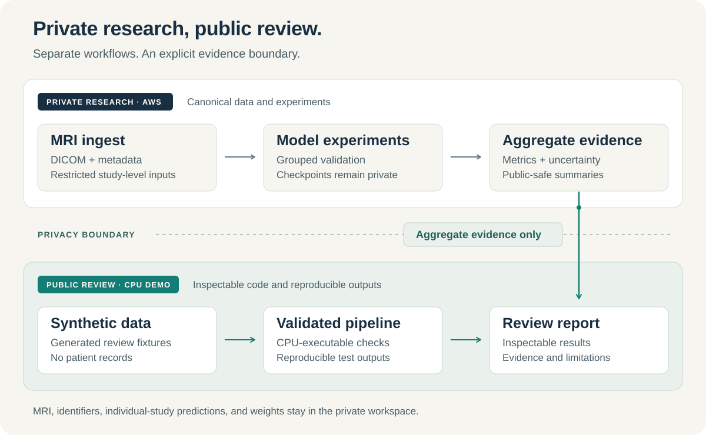
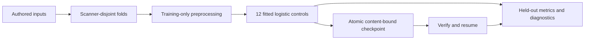

# System architecture

The recorded MRI system and public reference are distinct. The former used private
images and trained model artifacts. The latter exposes the implementation contracts,
fitted synthetic controls, and original final aggregate evaluation.

## Data and model identity

The recorded cache contains 4,407 studies. The grouped development population is
4,349 studies in 59 scanner groups, with no group crossing folds. The 58 fully
labeled audit rows have historical selection exposure and are not untouched
confirmation. Exact private split membership is not reconstructed by a count check.

## Retained contracts

| Layer | Implementation | Scope |
|---|---|---|
| Input integrity | `rsna_knee/schema.py`, `downloads.py` | Label order, metadata joins, bounded safe CSV input |
| MRI preprocessing | `rsna_research/pixels.py` | Physical slice order, geometry rejection, bounded decoding |
| Global pooling | `rsna_research/image_models.py` | Softmax over all encoding microbatches, not independent chunks |
| Evaluation | `rsna_research/comparison.py`, `rsna_knee/metrics.py` | Key alignment, twelve-target scoring, grouped uncertainty |
| Recovery | `rsna_review/public_pipeline.py` | Atomic, content-bound fold checkpoints |
| Reporting | `rsna_review/diagnostics.py`, `evidence.py` | Held-out probability diagnostics and exact aggregate replay |

## Public training path

An incompatible checkpoint stops rather than silently reusing stale work. Browser
and Python exports are independently testable and explicitly synthetic. The final
private MRI ensemble and tuned fusion are not shipped or impersonated by the
public reference. Numerical parity within a tested input scope does not establish
clinical validity or generalization to new acquisitions.

[Case study](EMPLOYER_CASE_STUDY.md) · [Reproduction](REPRODUCIBILITY.md) ·
[Original evidence](../reports/current_frontier/results.json)
